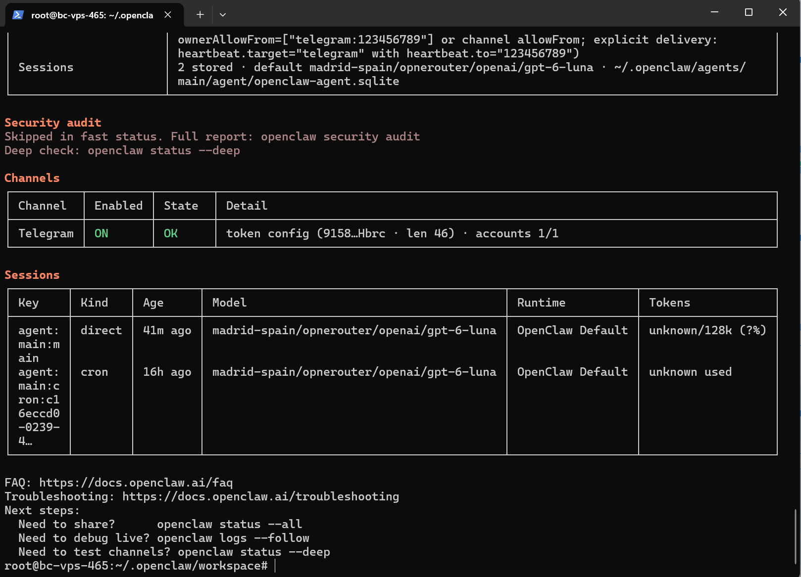

# Conecta tu Agente: Telegram, Google Docs y Calendario

Entrega del proyecto de integración de **OpenClaw (Atlas)** con **Telegram**, **Google Docs** y **Google Calendar**, mediante **Zapier MCP**.

## Resultado verificado

El flujo se ejecutó desde Telegram: solicitud → preguntas del agente para completar los datos → creación de un documento → reserva de tiempo para revisarlo → confirmación por Telegram. El historial de Zapier registra las dos acciones como **Success**.

- Documento: **Plan de estudio de OpenClaw — prueba de integración**, con cuatro apartados sobre canales, habilidades, seguridad y MCP.
- Evento: **Revisar plan de estudio de OpenClaw**, el **29 de octubre de 2026, de 10:00 a 10:30**, zona **Europe/Madrid**.
- El evento contiene el enlace al documento y se creó sin invitados.
- Atlas solicitó título, contenido, fecha, hora, duración, calendario y zona horaria antes de ejecutar.

## Evidencias

Las imágenes son capturas de las aplicaciones reales. Se muestran con contexto y se excluyen credenciales, códigos OAuth y datos personales. Los documentos y calendarios permanecen privados; las capturas permiten revisar la entrega sin acceder a la cuenta de prueba.

### 1. OpenClaw conectado al servidor MCP

### 2. Herramientas de Google Docs y Calendar

Se habilitaron únicamente **Create Document From Text** y **Create Detailed Event**.

### 3. Solicitud por Telegram y preguntas del agente

### 4. Confirmación de finalización por Telegram

### 5. Documento creado en Google Docs

### 6. Evento creado en Google Calendar

### 7. Historial MCP con ambas ejecuciones exitosas

## Notas de configuración

Las decisiones de configuración y los problemas resueltos se describen en [notes.md](notes.md). No se incluyen archivos de configuración del servidor, tokens ni claves API.

## Comprobación contra la rúbrica

| Criterio | Evidencia |
| --- | --- |
| Telegram creado y conectado a OpenClaw | `01-telegram-conectado.png`: Telegram ON / OK; conversación real en `04` y `05` |
| MCP agregado y activo en el agente | `02-zapier-mcp-conectado.jpg`: OpenClaw Connected |
| Google Docs crea un documento | `03`, `06` y `08`: herramienta, documento y Success |
| Google Calendar reserva tiempo para revisar el documento | `05`, `07` y `08`: confirmación, fecha/hora e historial |
| Confirmación por Telegram | `05-telegram-confirmacion.jpg` |
| Preguntas ante información insuficiente | `04-telegram-solicitud-y-aclaraciones.jpg` |
| Secuencia completa de la prueba | `04`, `05` y [transcripción anonimizada](conversacion.md), que incluye los parámetros enviados |
| Sin credenciales ni datos personales en la entrega | Capturas revisadas; token de Telegram visible solo como fragmento enmascarado por OpenClaw |
| Notas breves | `notes.md`, 10 líneas |
| Entrega por GitHub | Repositorio `openclaw-connection` con capturas y notas en su carpeta raíz |

### Conexión inicial de Telegram en OpenClaw

El mensaje de parámetros del chat contiene la dirección de la cuenta de prueba; se documenta íntegramente con ese dato anonimizado en `conversacion.md`. Las capturas no reproducen el correo.
